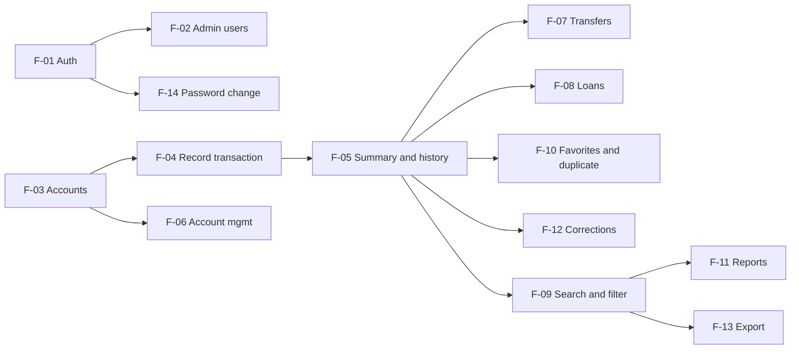

# YourMoneyOurMoney — Three-Sprint Plan

> **Status:** Sprint 1 baseline (S1-09), 4 Nov 2026; feature list reconciled with `docs/features.md` in S1-15
> (5 Nov 2026). `docs/features.md` (S1-03) is the authoritative feature inventory and requirement mapping; §3
> below matches it. Changes to scope after the baseline are recorded in §6, not by rewriting earlier rows.

## 1. Product goal

Each user privately records money movements across cash, bank, credit-card, loan, income and expense accounts,
and sees correct balances, outstanding loans, credit-card debt, and income/expense summaries. Administrators
manage platform access but never see financial data.

**Out of scope for the whole product** (Theme 7 brief): period budgets, shared budgets, automatic recurring
transactions, bank integration, real payments or external APIs.

## 2. Course deadlines

Fixed by the course specification (23:59 on each date). How the team paces work between them is not fixed.

| Due | Deliverable | Must contain |
|---|---|---|
| **Sun 8 Nov** | **Project Deliverable 1** | Baseline docs + working Sprint 1 on `main`, tag `v0.1.0` |
| Sun 15 Nov | Lab 5 | Sprint 1 release containerised, CI/CD, deployed on GCP |
| Sun 22 Nov | Lab 6 | Cross-team UAT, defect triage, one fixed and re-tested defect |
| **Sun 29 Nov** | **Project Deliverable 2** + Lab 7 | All Sprint 2 features complete; Sprint 3 contracts + implemented progress + remaining-work list; deployed release candidate · Lab 7 maintenance change |
| **Sun 13 Dec** | **Final delivery** | Complete release, report, demo video |

Sprint 1 ends at Deliverable 1, Sprint 2 must be complete by Deliverable 2, and Sprint 3 ends at final delivery.
The final examination period is 1 – 11 Dec.

## 3. Feature allocation

| ID | Feature | Sprint | Depends on |
|---|---|---|---|
| F-01 | Authentication: login, logout, current user, sessions | **1** | — |
| F-02 | Admin user management: list users, enable / disable | **1** | F-01 |
| F-03 | Accounts (seeded) and opening balances | **1** | — |
| F-04 | Record a transaction: Payment and Receive with allocation lines | **1** | F-03 |
| F-05 | Balances, credit-card debt, income/expense summary, transaction history | **1** | F-04 |
| F-06 | Custom account & category management: create, rename and archive accounts; edit opening balances | 2 | F-03 |
| F-07 | Internal account transfers between Cash accounts | 2 | F-04, F-05 |
| F-08 | Debt & receivable lifecycle: lend, borrow, repay; outstanding loans view | 2 | F-04, F-05 |
| F-09 | Transaction search, filtering & sorting: date range, account, kind, text | 2 | F-05 |
| F-10 | Favorite & Duplicate transactions | 2 | F-04, F-05 |
| F-11 | Financial reports & periodic spending summaries (charts are a team addition) | 3 | F-05, F-09 |
| F-12 | Transaction editing, voiding & corrections, balances recomputed | 3 | F-04, F-05 |
| F-13 | Data export (CSV & JSON) [Added by Team] | 3 | F-05, F-09 |
| F-14 | User profile & security settings: self-service password change [Added by Team] | 3 | F-01 |

Sprint 3 also includes hardening work that is not a feature of its own: failure handling, usability, the
authorization regression suite and responsive-layout checks (see §4, Sprint 3).

Why this order:
- **Sprint 1** is the thinnest end-to-end slice the spec asks for: authentication, both roles, persistence,
  the demo journey, a business-rule rejection (allocation mismatch) and access restrictions.
- **Sprint 2** completes the money workflows the brief lists — every account type, transfers, loans,
  search, favorites and duplicate. Most of the ledger logic already exists after F-04 (the balance rules in
  `system-sds.md` §4 cover all line types), so Sprint 2 is mainly new UI, validation and tests on it.
- **Sprint 3** adds corrections and reports, the two team additions, and hardens the product before release
  and the exam period.

### 3.1 Dependencies

F-01/F-02 and F-03…F-05 have no code dependency on each other, which is what lets two people build Sprint 1
in parallel (`sprint-1-issues.md`, dependency map).

## 4. Sprint goals

### Sprint 1 — small deployable product (due 8 Nov)

**Goal:** a seeded user logs in, records an opening bank balance, salary, a split credit-card purchase and a
card repayment, and sees the correct bank balance (38,500.00), card debt (0), income (30,000.00), expense
(1,500.00) and history. An administrator can disable a user but cannot reach any financial data.

| Track | Issues |
|---|---|
| Together | S1-01 scaffold ✅ · S1-02 shared contracts ✅ |
| A | S1-03 SRS + traceability ✅ · S1-04 contract ✅ · S1-05 login ✅ · S1-06 authorization ✅ · S1-07 admin ✅ · S1-08 UI + E2E ✅ |
| B | S1-09 SDS + this plan ✅ · S1-10 contract ✅ · S1-11 accounts ✅ · S1-12 transactions ✅ · S1-13 summary ✅ · S1-14 UI ✅ |
| Together | S1-15 integration + demo-journey E2E · S1-16 release `v0.1.0` + evidence |

**Feasibility.** Sprint 1 is limited to what the spec's Theme 7 Sprint 1 example requires, with seeded
accounts instead of account management. After S1-02 the two tracks have no code dependency on each other.
The riskiest items are S1-12 (allocation rules) and S1-14 (allocation form UI). If scope must shrink, Sprint 1
keeps the demo journey and access tests and defers polish — not tests.

### Sprint 2 — core expansion (complete by 29 Nov)

**Goal:** F-06 to F-10 — every account type, transfers, loans, search and filters, favorites and duplicate work
end to end. Each feature has a contract merged before its code.

Also due during Sprint 2: **Lab 5** containerises and deploys the Sprint 1 release; **Lab 6** runs cross-team UAT on
a recorded release and fixes at least one accepted defect. Lab work is tracked in its own Issues/PRs, separate
from feature work.

### Sprint 3 — completion and hardening (contracts by 29 Nov, release 13 Dec)

**Goal:** F-11 to F-14 (reports, corrections, export, password change) and hardening are done; the full
regression suite passes on the deployed release. By 29 Nov: Sprint 3 contracts merged, first features implemented, and an explicit
remaining-work list. **Lab 7** applies one approved change to an existing rule with regression tests.

## 5. Working agreements

- Assignments are made at each sprint's planning, not fixed per person: both members work across
  requirements, contracts, backend, frontend, tests, review and deployment, as the spec requires.
- One Issue per bounded change; one branch per Issue, cut from the latest `Sprint-1/staging` (later
  `Sprint-2/staging`, `Sprint-3/staging`); PR into staging; teammate approval before merge.
- Contract before code: a feature's contract PR merges before its first implementation PR.
- Release: reviewed PR from sprint staging to `main`, then a tag (`v0.1.0`, `v0.2.0`, `v1.0.0`).

### 5.1 Product Definition of Done

Every feature contract's own Definition of Done (F-0x §8 or §9) adds feature-specific items to this list. A
feature, and a sprint release, is done only when all of these hold, each backed by evidence (test output, a
reviewed PR, a document) rather than an AI agent's or an author's claim:

1. **Behaviour:** every acceptance criterion in the feature contract is implemented, including its negative,
   boundary and role-restriction cases.
2. **Verification executed:** every test planned in the contract's test specification exists under its test
   ID and was run; for rule work, the test was seen failing before the implementation and passing after.
3. **Tests passing:** `npm --prefix server test`, `npm --prefix client test` and `npm run test:e2e` pass, and
   `npm run lint`, `npm run format:check` and both type checks are clean. No required test is skipped,
   weakened or removed to make the result pass.
4. **Reviewed and integrated:** the PR into sprint staging is approved by the teammate (never self-approved)
   with a specific check or finding recorded, and the integrated staging branch passes the full suite.
5. **Documents current:** the contract, `docs/traceability.md` rows (AC → test → result) and the README setup
   and test commands match the merged code; contract changes are versioned in the contract's change log.
6. **Disclosed:** incomplete work, known limitations and any failed or skipped test are listed in the sprint
   record (for Sprint 1, `docs/sprints/sprint-1/integration.md` §5).

## 6. Remaining work and change log

**Remaining after Sprint 1:** F-06 to F-14, Sprint 3 hardening, Lab 5–7 deliverables, Docker/CI/GCP pipeline.

| Date | Change | Reason |
|---|---|---|
| 4 Nov 2026 | Baseline plan | S1-09 |
| 5 Nov 2026 | §3 renumbered to match `docs/features.md` (S1-03): transfers and loans split into F-07 / F-08 | Reconciliation in S1-15; `features.md` is the authoritative inventory |
| 5 Nov 2026 | Transaction corrections moved from Sprint 2 to Sprint 3 (now F-12) | As defined in `features.md` (S1-03, PR #20, reviewed and approved); Sprint 2 keeps the brief's core money workflows |
| 5 Nov 2026 | Admin account administration (create users, reset passwords) dropped; replaced by F-14 self-service password change | As defined in `features.md` (PR #20); seeded accounts meet the spec and the brief does not require it |
| 5 Nov 2026 | F-13 data export added as a team addition | As defined in `features.md` (PR #20) and SRS DL-09 |
| 5 Nov 2026 | Hardening moved from a feature (old F-13) to Sprint 3 work | It is a quality activity, not a user-facing feature |
