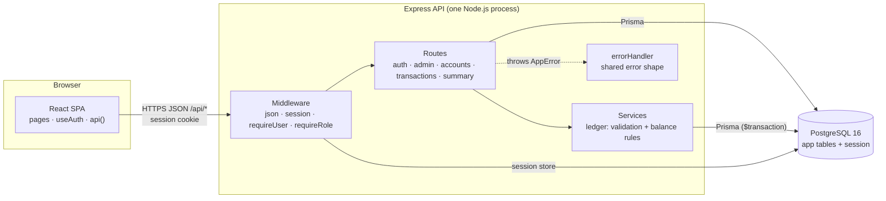
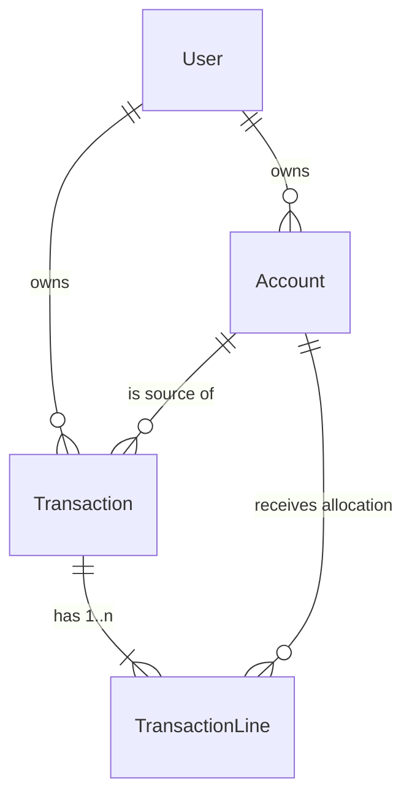
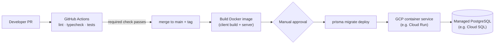

# YourMoneyOurMoney — System-Level SDS

> **Status:** Sprint 1 baseline. Sections 2–7 are the **shared contracts frozen in S1-02** — both tracks code
> against them, and any change needs a PR reviewed by both members. Sections 1 and 8 were added in **S1-09**.
> Business-rule IDs (BR-xx) are defined in `docs/srs.md` (S1-03); they are quoted here for convenience.
> The sprint-by-sprint feature allocation is in `docs/sprints/plan.md`.

| § | Section | Owner issue |
|---|---|---|
| 1 | Architecture, stack and UI structure | S1-09 |
| 2 | Roles and permission matrix | S1-02 |
| 3 | Data model | S1-02 |
| 4 | Balance rules | S1-02 |
| 5 | API | S1-02 |
| 6 | Code integration points | S1-02 |
| 7 | Folder layout and ownership | S1-02 |
| 8 | Configuration and deployment | S1-09 |

---

## 1. Architecture, stack and UI structure

### 1.1 Architecture

A **modular monolith**: one browser app, one API process, one database. Three logical layers, as the course
spec requires (UI → API/application layer → persistent database), without microservices.



**Request path.** `express.json()` → session lookup (cookie → `session` table) → `requireUser` loads the user
into `req.user` → `requireRole` → route validates input with zod → service applies business rules and writes
through Prisma inside one database transaction → JSON response. Any thrown error ends in `errorHandler`,
which returns `{ error: { code, message, details? } }` (§5.1).

**Layer responsibilities.**

| Layer | Does | Does not |
|---|---|---|
| React client | Screens, form state, baht ↔ satang conversion, route guards for navigation | Enforce permissions or business rules (the server re-checks everything) |
| Routes (`server/src/routes/`) | Auth guards, input parsing with zod, ownership checks (`assertOwned`), shaping responses | Contain balance or allocation logic |
| Services (`server/src/services/`) | Business rules (BR-01, 02, 09–13), balance computation (§4) | Read `req` / `res` — plain functions, unit-testable |
| Database | Persistence, constraints (§3.3), sessions | — |

### 1.2 Stack and why

The course encourages reusing the Labs 1–4 (TokTickIT) stack; we did, so both members start with tools they
already know. Choices specific to this product are marked ★.

| Area | Choice | Why |
|---|---|---|
| Language | TypeScript 5.7, client and server | One language end to end; shared shapes are type-checked |
| UI | React 18, Vite 6, React Router 7, Bootstrap 5.3 | Known from Labs 1–4; Bootstrap gives usable forms and tables with little custom CSS |
| API | Express 4 (REST, JSON) | Known from Labs 1–4; small, easy to test with Supertest |
| Validation | ★ zod | One schema both validates requests and produces field-level error details for the 400 response |
| Database | PostgreSQL 16 | Real transactions for all-or-nothing saves (BR-13); CHECK constraints and composite foreign keys enforce rules in the database (§3.3) |
| Data access | Prisma 5 | Typed queries, versioned migrations, seed script |
| Sessions | `express-session` + `connect-pg-simple` | ★ Server-side sessions can be invalidated at once when an admin disables a user (BR-06); a stateless token would stay valid until it expired |
| Passwords | bcryptjs | Hashing without native build tools on Windows dev machines |
| Money | ★ integers in satang | Exact arithmetic: allocation lines must equal the total exactly (BR-01), which floating point cannot guarantee |
| Tests | Vitest + Supertest, React Testing Library, Playwright | Unit, API/database, and end-to-end levels as the spec requires |
| Code quality | ★ ESLint + Prettier | Lint and format become CI checks in Lab 5 |

### 1.3 Testing architecture

| Level | Tool | Database | Location |
|---|---|---|---|
| Unit | Vitest | none | `server/test/unit/`, `client/test/` |
| API / database | Vitest + Supertest | `ymom_test` (separate from dev), migrated by `test/globalSetup.ts`, reset by `resetDb()` | `server/test/api/` |
| End to end | Playwright (Chromium) | dev database, seeded | `e2e/` |

API tests log in with `agentAs(username)` through a route that exists only when `NODE_ENV=test` (§5.2), so
data-side features can be tested without depending on the login feature.

### 1.4 UI structure and conventions

**Screens (Sprint 1).** Routes live in `client/src/App.tsx`; every page sits inside the shared `Layout`
(navbar with username and Log out).

| Route | Role | Screen | Issue |
|---|---|---|---|
| `/` | any | Redirects: logged out → `/login`, USER → `/dashboard`, ADMIN → `/admin/users` | S1-01 |
| `/login` | anonymous | Login form | S1-08 |
| `/dashboard` | USER | Balances, credit-card debt, income vs expense, category totals | S1-14 |
| `/accounts/:id/opening-balance` | USER | Set an account's opening balance | S1-14 |
| `/transactions/new?kind=PAYMENT\|RECEIVE` | USER | Payment or Receive form with allocation lines | S1-14 |
| `/transactions` | USER | Transaction history | S1-14 |
| `/transactions/:id` | USER | One transaction with its lines | S1-14 |
| `/admin/users` | ADMIN | User list with enable/disable | S1-08 |
| `*` | any | Not found | S1-01 |

The S1-14 routes are the planned shape; S1-10's UI spec may adjust them.

**Conventions.**
- **Access.** `<RequireRole>` wraps every role-only page: logged out → `/login`; wrong role → that role's home.
  This is navigation only; the server enforces every permission.
- **Money.** Users type and read **baht** with two decimals (`1,500.00`); the client converts with
  `toSatang` / `formatBaht` and always sends satang. Amounts are right-aligned in tables.
- **Dates.** Shown and entered as calendar dates; sent as `YYYY-MM-DD`.
- **Errors.** A failed request shows the server's `message` in a Bootstrap alert above the form; field-level
  `details` from `VALIDATION_ERROR` highlight the matching inputs. The client never invents business-rule
  messages of its own.
- **Loading.** A spinner with `role="status"` while data loads; buttons are disabled while a request is in flight
  so a double click cannot submit twice.
- **Accessibility.** Every input has a `<label>`; headings follow page structure (one `h1` per page); tests
  find elements by role and accessible name.

---

## 2. Roles and permission matrix

Two roles. One role per account. Every rule below is enforced on the server; the client only hides links.

| Capability | Anonymous | USER | ADMIN |
|---|---|---|---|
| Log in | ✅ | — | — |
| Log out, view own identity (`/api/auth/*`) | — | ✅ | ✅ |
| Own accounts, transactions, favorites, summaries | ❌ 401 | ✅ own only | ❌ **403** (BR-05) |
| Another user's financial records | ❌ 401 | ❌ **404** (BR-04) | ❌ 403 |
| List users, enable/disable users (`/api/admin/*`) | ❌ 401 | ❌ 403 | ✅ (not self-disable, BR-07) |
| Read any financial data through admin routes | — | — | ❌ never returned (BR-05) |

- **401** = no valid session (or the user was disabled since logging in, BR-06).
- **403** = logged in, wrong role.
- **404** = the record does not exist **or** belongs to someone else. The two cases are indistinguishable on purpose.

---

## 3. Data model

### 3.1 Tables

Defined in `server/prisma/schema.prisma`. All money is **integer satang** (1 THB = 100 satang, BR-03).
The largest storable amount is 2,147,483,647 satang (≈ 21.4 million THB) per value.

| Table | Purpose | Key columns |
|---|---|---|
| `User` | Login identity | `username` (unique), `passwordHash` (bcrypt), `role` USER\|ADMIN, `isEnabled` |
| `Account` | A user's financial account or category | `userId`, `name` (unique per user), `type`, `subtype`, `openingBalance`, `openingDate` |
| `Transaction` | One Payment or Receive | `userId`, `kind` PAYMENT\|RECEIVE, `sourceAccountId`, `date` (DATE), `totalAmount`, `note`, `isFavorite` |
| `TransactionLine` | One allocation line of a transaction | `transactionId`, `userId`, `accountId`, `amount` |
| `session` | Login sessions (connect-pg-simple) | `sid`, `sess`, `expire` — declared as model `Session` only so Prisma owns the table; app code never uses it through Prisma |

Account `type` and `subtype`:

| `type` | Meaning | Allowed `subtype` | Examples |
|---|---|---|---|
| `CASH` | Money the user holds | `BANK`, `WALLET`, or none | Bank account, wallet |
| `LOAN_TAKEN` | Money the user owes | `CREDIT_CARD` or none | Credit card, loan from a friend |
| `LOAN_GIVEN` | Money owed to the user | none | Loan to a friend |
| `INCOME` | Income category | none | Salary, Interest |
| `EXPENSE` | Expense category | none | Dining, Groceries, Electricity, Telecom |

### 3.2 Relationships



`Transaction` → source `Account` and `TransactionLine` → `Account` / `Transaction` use **composite foreign keys
on `(id, userId)`**. A transaction or line can therefore only reference accounts and transactions of the same
user, even if application code has a bug.

### 3.3 Where each rule is enforced

| Rule | Database (migration `add_financial_tables`) | Service code |
|---|---|---|
| BR-01 lines sum to total | — | ✅ `ALLOCATION_MISMATCH` |
| BR-02 amounts > 0 | ✅ `Transaction_totalAmount_positive`, `TransactionLine_amount_positive` | ✅ `VALIDATION_ERROR` |
| BR-04 own records only | ✅ composite FKs on `(id, userId)` | ✅ `assertOwned` → 404 |
| BR-09 source type per form | — | ✅ `INVALID_ACCOUNT_TYPE` |
| BR-10 line type per form | — | ✅ `INVALID_ACCOUNT_TYPE` |
| BR-11 source not used as a line | — | ✅ `VALIDATION_ERROR` |
| BR-12 opening balance only on CASH / LOAN_* | ✅ `Account_openingBalance_allowed_type`, `Account_openingBalance_nonnegative` | ✅ `INVALID_ACCOUNT_TYPE` |
| BR-13 all-or-nothing save | — | ✅ one `prisma.$transaction` |
| Subtype fits type | ✅ `Account_subtype_matches_type` | (seed data only in Sprint 1) |
| Account name unique per user | ✅ `Account_userId_name_key` | — |
| Cannot delete an account in use | ✅ `ON DELETE RESTRICT` | — |

Services validate **first** so users get a clear 400; the database constraints are the last line of defence.
CHECK constraints are written by hand in the migration SQL because Prisma cannot declare them; Prisma does
not track them, so later migrations leave them in place.

**Migration rule:** never edit an applied migration. Add a new one (`npx prisma migrate dev --name ...`).

---

## 4. Balance rules

Balances are **computed** from the opening balance plus transaction effects; they are never stored.
Each account's balance means:

| `type` | Balance means | Shown as |
|---|---|---|
| `CASH` | money held | balance |
| `LOAN_TAKEN` | money the user owes | outstanding debt |
| `LOAN_GIVEN` | money owed to the user | outstanding receivable |
| `INCOME` / `EXPENSE` | running total for the category | income / expense total |

### 4.1 Effect of a transaction on each account

`T` = transaction total, `a` = a line's amount.

| Form | Source account | Line → `EXPENSE` | Line → `INCOME` | Line → `LOAN_TAKEN` | Line → `LOAN_GIVEN` | Line → `CASH` |
|---|---|---|---|---|---|---|
| **PAYMENT** | `CASH`: **−T** · `LOAN_TAKEN`: **+T** | **+a** expense | not allowed | **−a** repayment | **+a** lend | **+a** transfer in |
| **RECEIVE** | `CASH`: **+T** | not allowed | **+a** income | **+a** new borrowing | **−a** repaid to user | **−a** transfer out |

Allowed sources (BR-09): PAYMENT from `CASH` or `LOAN_TAKEN`; RECEIVE into `CASH` only.

So for any account:

```
balance(account) = openingBalance
                 + Σ source effects of transactions whose source is this account
                 + Σ line effects of lines on this account
```

### 4.2 Income and expense (BR-08)

- **Income** = sum of RECEIVE lines on `INCOME` accounts. **Expense** = sum of PAYMENT lines on `EXPENSE` accounts.
- Nothing else counts: transfers, borrowing, repayments and opening balances never appear in income or expense.

### 4.3 Worked example — the Sprint 1 demo journey

| Step | Transaction | Bank | Card debt | Income | Expense |
|---|---|---|---|---|---|
| 1 | Opening balance on Bank: 10,000.00 | 10,000.00 | 0 | 0 | 0 |
| 2 | RECEIVE into Bank 30,000.00 → Salary 30,000.00 | 40,000.00 | 0 | 30,000.00 | 0 |
| 3 | PAYMENT from Card 1,500.00 → Dining 900.00 + Groceries 600.00 | 40,000.00 | 1,500.00 | 30,000.00 | 1,500.00 |
| 4 | PAYMENT from Bank 1,500.00 → Card 1,500.00 (repayment) | **38,500.00** | **0** | **30,000.00** | **1,500.00** |

Category totals after step 4: Salary 30,000.00 · Dining 900.00 · Groceries 600.00. In the API these are
`3850000`, `0`, `3000000`, `150000`, `90000`, `60000` satang.

### 4.4 Decisions on earlier open questions (S1-10)

Recorded in `docs/sprints/sprint-1/F-04-transactions.md` §8:

- **Overdraft:** allowed. A CASH balance may go negative; there is no balance check when saving.
- **Transaction dates:** any real calendar date from 2000-01-01 to 2099-12-31, including future dates.

---

## 5. API

### 5.1 Conventions

- Base path `/api`. JSON in and out. Session cookie `ymom.sid` (HTTP-only, SameSite=Lax).
- **Money:** integer satang everywhere in the API. The client converts to and from baht for display.
- **Dates:** `YYYY-MM-DD` strings (no time, no time zone).
- **IDs:** integers.
- **Errors:** always `{ "error": { "code": string, "message": string, "details"?: any } }`.

| Status | Codes |
|---|---|
| 400 | `VALIDATION_ERROR`, `ALLOCATION_MISMATCH`, `INVALID_ACCOUNT_TYPE`, `SELF_DISABLE_NOT_ALLOWED` |
| 401 | `UNAUTHENTICATED`, `INVALID_CREDENTIALS` |
| 403 | `FORBIDDEN`, `ACCOUNT_DISABLED` |
| 404 | `NOT_FOUND` |
| 500 | `INTERNAL_ERROR` (no internal details are ever returned) |

New codes are added to `server/src/lib/errors.ts` **and** this table in the same PR.

### 5.2 Endpoint map

| Method | Path | Role | Owner | Issue |
|---|---|---|---|---|
| POST | `/api/auth/login` | anonymous | A | S1-05 |
| POST | `/api/auth/logout` | any logged in | A | S1-05 |
| GET | `/api/auth/me` | any logged in | A | S1-05 |
| GET | `/api/admin/users` | ADMIN | A | S1-07 |
| PATCH | `/api/admin/users/:id` | ADMIN | A | S1-07 |
| GET | `/api/accounts` | USER | B | S1-11 |
| PUT | `/api/accounts/:id/opening-balance` | USER | B | S1-11 |
| POST | `/api/transactions` | USER | B | S1-12 |
| GET | `/api/transactions` | USER | B | S1-13 |
| GET | `/api/transactions/:id` | USER | B | S1-13 |
| GET | `/api/summary` | USER | B | S1-13 |
| GET | `/api/health` | anonymous | shared | S1-01 |
| GET | `/api/ready` | anonymous | shared | L5-02 |
| POST | `/api/test/login-as` | **test only** (`NODE_ENV=test`) | shared | S1-01 |

### 5.3 Request and response shapes

The feature contracts (S1-04, S1-10) may add fields, validation details and error cases, but must not
rename or remove anything below without a PR reviewed by both members.

**Auth**

| Endpoint | Request | Success | Errors |
|---|---|---|---|
| `POST /api/auth/login` | `{ username, password }` | `200 { id, username, role }` + cookie | 400 `VALIDATION_ERROR`, 401 `INVALID_CREDENTIALS`, 403 `ACCOUNT_DISABLED` |
| `POST /api/auth/logout` | — | `204` | 401 |
| `GET /api/auth/me` | — | `200 { id, username, role }` | 401 |

**Admin**

| Endpoint | Request | Success | Errors |
|---|---|---|---|
| `GET /api/admin/users` | — | `200 { users: [{ id, username, role, isEnabled }] }` | 401, 403 |
| `PATCH /api/admin/users/:id` | `{ isEnabled: boolean }` | `200 { user: { id, username, role, isEnabled } }` | 400 `VALIDATION_ERROR` / `SELF_DISABLE_NOT_ALLOWED`, 401, 403, 404 |

Admin responses never contain accounts, transactions or balances (BR-05).

**Accounts**

| Endpoint | Request | Success | Errors |
|---|---|---|---|
| `GET /api/accounts` | — | `200 { accounts: [{ id, name, type, subtype, openingBalance, openingDate, balance }] }` | 401, 403 |
| `PUT /api/accounts/:id/opening-balance` | `{ openingBalance, openingDate }` | `200 { account }` (same shape as one list item) | 400 `VALIDATION_ERROR` / `INVALID_ACCOUNT_TYPE`, 401, 403, 404 |

**Transactions**

```
POST /api/transactions
{
  "kind": "PAYMENT" | "RECEIVE",
  "sourceAccountId": 2,
  "date": "2026-11-03",
  "totalAmount": 150000,
  "note": "Dinner and groceries",          // optional
  "lines": [ { "accountId": 7, "amount": 90000 }, { "accountId": 8, "amount": 60000 } ]
}
→ 201 { "transaction": Transaction }
→ 400 VALIDATION_ERROR | ALLOCATION_MISMATCH | INVALID_ACCOUNT_TYPE · 401 · 403 · 404 (an account is not the user's)
```

```
Transaction = {
  "id": 12, "kind": "PAYMENT", "date": "2026-11-03", "totalAmount": 150000,
  "note": "Dinner and groceries", "isFavorite": false,
  "source": { "id": 2, "name": "Credit Card" },
  "lines": [ { "accountId": 7, "name": "Dining", "amount": 90000 },
             { "accountId": 8, "name": "Groceries", "amount": 60000 } ]
}
```

| Endpoint | Success | Errors |
|---|---|---|
| `GET /api/transactions` | `200 { transactions: Transaction[] }` newest `date` first, then newest `id` | 401, 403 |
| `GET /api/transactions/:id` | `200 { transaction: Transaction }` | 401, 403, 404 |

**Summary**

```
GET /api/summary → 200
{
  "cash":       [ { "accountId": 1, "name": "Bank", "balance": 3850000 } ],
  "loansTaken": [ { "accountId": 2, "name": "Credit Card", "outstanding": 0 } ],
  "loansGiven": [],
  "totals":     { "income": 3000000, "expense": 150000 },
  "income":     [ { "accountId": 3, "name": "Salary", "total": 3000000 } ],
  "expense":    [ { "accountId": 7, "name": "Dining", "total": 90000 },
                  { "accountId": 8, "name": "Groceries", "total": 60000 } ]
}
```

Every account of the matching type is listed, including those with a zero total.

---

## 6. Code integration points

The fixed names where Track A and Track B code meets. **If something you need is not here or in the merged
code, ask your teammate — do not create your own version.** This section replaces the earlier
`integration-points-and-agent-instructions.md` note.

| # | What | Definition | Location | Owner |
|---|---|---|---|---|
| 1 | Session | `req.session.userId: number`; set at login, destroyed at logout | `server/src/types/express.d.ts` | A (S1-05) |
| 2 | Current user | `requireUser` sets `req.user: { id, username, role }`; 401 `UNAUTHENTICATED` otherwise. Disabled-user check added in S1-06 | `server/src/middleware/auth.ts` | A (S1-06) |
| 3 | Role check | `requireRole("USER" \| "ADMIN")` → 403 `FORBIDDEN`. Financial routes: `requireUser, requireRole("USER")`. Admin routes: `requireUser, requireRole("ADMIN")` | `server/src/middleware/auth.ts` | A (S1-06) |
| 4 | Ownership | `assertOwned(record, userId)` → returns the record, or throws 404 `NOT_FOUND` | `server/src/lib/ownership.ts` | shared |
| 5 | Errors | `throw new AppError(status, ErrorCode.X, message, details?)`; wrap async handlers in `asyncHandler` | `server/src/lib/errors.ts`, `asyncHandler.ts` | shared |
| 6 | Error codes | §5.1 table = `ErrorCode` in `errors.ts` | `server/src/lib/errors.ts` | shared |
| 7 | Test login | `await agentAs("alice")` → logged-in Supertest agent; `await resetDb()` in `beforeAll` | `server/test/helpers/` | shared |
| 8 | Seed data | Users `alice`, `bob` (USER), `admin` (ADMIN). Accounts per USER added in S1-11 | `server/prisma/seedData.ts` | users: shared · accounts: B (S1-11) |
| 9 | Money (client) | `toSatang(baht: string): number`, `formatBaht(satang: number): string` | `client/src/lib/money.ts` | B (S1-14) |
| 10 | Frontend auth | `useAuth(): { user, loading, login, logout }`; `<RequireRole role="USER" \| "ADMIN">` | `client/src/auth/` | A (S1-08) |
| 11 | API client | `api<T>(path, init?)` → throws `ApiError { status, code, message, details }` | `client/src/api/client.ts` | shared |

---

## 7. Folder layout and ownership

```
server/
  prisma/schema.prisma, migrations/      shared — PR reviewed by both
  prisma/seedData.ts                     shared (users) · B adds accounts in S1-11
  src/app.ts                             shared — middleware + route mounting only
  src/session.ts, src/prisma.ts          shared
  src/middleware/auth.ts                 A
  src/routes/auth.routes.ts              A
  src/routes/admin.routes.ts             A
  src/routes/accounts.routes.ts          B
  src/routes/transactions.routes.ts      B
  src/routes/summary.routes.ts           B
  src/services/ledger.ts                 B — validation (BR-01, 02, 09–11) and balance rules (§4)
  src/lib/                               shared
  test/unit/, test/api/                  each person owns the tests for their own features
  test/helpers/                          shared
client/src/
  auth/, pages/Login*, pages/Admin*      A
  pages/Dashboard*, pages/Transaction*   B
  lib/money.ts                           B
  api/client.ts, App.tsx                 shared — App.tsx is the route table only
e2e/                                     A: auth/admin specs · B: transaction specs · both: journey spec (S1-15)
docs/system-sds.md                       shared — this document
```

---

## 8. Configuration and deployment

### 8.1 Configuration

All configuration comes from environment variables; nothing environment-specific is hard-coded.
Real values are never committed — `.env` files are git-ignored, while `server/.env.example` and `client/.env.example` list every variable.

| Variable | Used by | Dev / test value | Production (planned) |
|---|---|---|---|
| `DATABASE_URL` | Prisma, session store | `ymom` on `localhost:5434` (Docker) | Cloud SQL connection string, from Secret Manager |
| `SESSION_SECRET` | Session cookie signing | any long random string; tests use a fixed test-only value | random secret from Secret Manager |
| `PORT` | API listen port (`0.0.0.0`) | `3000` | set by Cloud Run |
| `NODE_ENV` | Cookie `Secure` flag, `trust proxy`, static SPA serving, seed guards, test-only routes | `development`; `test` under Vitest | `production` |
| `ADMIN_PASSWORD` | Seed script (`admin` password) | optional (defaults to `DEMO_PASSWORD` outside production) | required in production, from Secret Manager |
| `SEED_DEMO_DATA` | Seed script (`alice`, `bob` + accounts) | optional (`true` by default outside production) | `false` by default (`true` when seeding demo data) |
| `DEMO_USER_PASSWORD` | Seed script (`alice`, `bob` password) | optional (defaults to `DEMO_PASSWORD` outside production) | required when `SEED_DEMO_DATA=true`, from Secret Manager |
| `CLIENT_DIST_DIR` | Express static SPA serving (optional) | defaults to `client/dist` when built | defaults to `client/dist` inside the container |
| `TEST_DATABASE_URL` | Vitest only (optional) | defaults to `ymom_test` on `localhost:5434` | not used |
| `E2E_DATABASE_URL` | Playwright E2E only (optional) | defaults to `ymom` on `localhost:5434` | not used |
| `API_PROXY_TARGET` | Vite dev server `/api` proxy (`client/`) | defaults to `http://localhost:3000` | not used (Express serves the built client) |

Rules:
- The server **refuses to start** without `DATABASE_URL` or `SESSION_SECRET` (`server/src/session.ts`).
- `NODE_ENV=production` turns on `app.set("trust proxy", 1)` and the `Secure` cookie flag, so production must be served over HTTPS.
- Outside `NODE_ENV=test`, Express serves `client/dist` (or `CLIENT_DIST_DIR`) and falls back to `index.html` for non-`/api` GET requests when the built client is present.
- Health & readiness probes: `GET /api/health` returns `200 { status: "ok" }` (liveness); `GET /api/ready` runs `SELECT 1` via Prisma and returns `200 { status: "ready", db: "connected" }` or `503 { status: "not_ready" }` (database readiness).
- Test-only routes (`/api/test/*`) exist only when `NODE_ENV=test`; a test proves they are absent otherwise.
- Database changes ship only as Prisma migrations; demo data comes from the idempotent seed script (`ADMIN_PASSWORD` required in production; demo users gated behind `SEED_DEMO_DATA=true` and `DEMO_USER_PASSWORD`), so any environment
  can be rebuilt reproducibly (`prisma migrate deploy` then `prisma db seed`).

### 8.2 Environments

| Environment | Runs | Database | Purpose |
|---|---|---|---|
| Local dev | `npm run dev` in `server/` and `client/`; Vite proxies `/api` | Docker `ymom` | Development, manual checks, Playwright |
| Local test | `npm test` | Docker `ymom_test` | Automated unit and API/database tests |
| CI (Lab 5) | GitHub Actions | PostgreSQL service container | Lint, type check, tests on every PR |
| Production (Lab 5) | One container on GCP | Managed PostgreSQL | Deployed releases from `main` |

The spec does not require a separate cloud staging environment; `Sprint-1/staging` is a Git branch for
integration, not a deployment.

### 8.3 Planned deployment (built in Lab 5, due 15 Nov)

This is the plan the code is designed for now; Lab 5's GCP access instructions may change the services used.



- **One image.** A multi-stage Dockerfile builds the React client and the server; in production Express also
  serves `client/dist`, so the browser and API share one origin and the SameSite=Lax cookie works unchanged.
  (Sprint 1 serves the client only through Vite in dev; static serving is added in Lab 5.)
- **Behind a proxy.** GCP terminates HTTPS in front of the container, so the server must set
  `app.set("trust proxy", 1)` in production for `Secure` cookies to be issued.
- **Persistence.** Data lives in managed PostgreSQL, outside the container, so it survives restarts and
  redeployments — a Lab 5 grading point.
- **Quality gate.** A failing required check blocks the merge to `main`, which blocks the release.
- **Migrations before traffic.** `prisma migrate deploy` runs as a release step before the new revision serves.
- **Secrets.** `DATABASE_URL` and `SESSION_SECRET` come from a secret store at runtime, never from the image.
